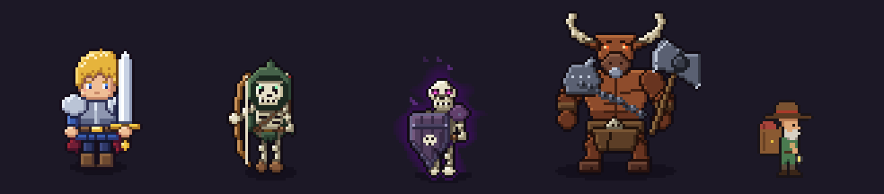

# LoopRogue

죽어도 강해져서 다시 도전하는 **턴제 루프 던전 RPG**. Unity로 만든 2D 도트 게임입니다.



<sub>왼쪽부터 플레이어 · 일반 몹(해골 궁수) · 정예 몹(정예 방패병) · 8층 보스 · NPC(상인)</sub>

## 게임 소개

- 던전은 **10층**, 층마다 **방 10개 + 보스방**으로 이루어져 있습니다.
- 죽으면 그 층의 첫 방으로 돌아가지만 **레벨·스탯·장비는 그대로** 남습니다. 죽을수록 강해져서 다시 도전하는 구조입니다.
- 층의 보스를 잡아야 다음 층으로 넘어갑니다.
- 죽거나 중도 포기하면 이번 시도에서 번 골드의 일부(40%)를 잃습니다.

## 주요 콘텐츠

- **층별 보스 10종**: 보스마다 고유 기믹(슬라임 왕, 미노타우르스, 포자 안개, 영혼 과녁, 그림자 박자, 리치의 낙인, 거울 기사 등)과 패턴 예고 칸
- **일반 몹·정예 몹**: 층이 올라갈수록 새 몹 추가, 정예 몹은 강화판
- **성장**: 레벨업 카드(등급제), 유물, 장비 가챠·대장장이, 영약, 런 버프
- **방 이벤트**: 상인, 마석 상인, 벽화, 저주, 퀘스트, 퍼즐 5종 + 미니게임 5종
- **로비**: 상점(영약), 도박장(슬롯), 가챠, 도감, 업적
- **편의**: 튜토리얼, 사망 리플레이(시간 되감기 연출), 키보드·모바일 터치 조작
- **언어**: 한국어, English, 日本語, 简体中文

## 개발 환경

| 항목 | 내용 |
|---|---|
| 엔진 | Unity **6000.3.21f1** (URP 2D) |
| 입력 | Input System (키보드 + 화면 터치 버튼) |
| 스팀 | Steamworks.NET (`steam_appid.txt`) |
| 대상 플랫폼 | Windows, Android |

## 시작하기

1. Unity Hub에서 **6000.3.21f1** 버전으로 프로젝트 폴더를 엽니다.
2. 에디터에서 **Play**를 누르면 지금 열린 씬과 상관없이 항상 **Title** 씬부터 시작합니다(`Assets/Editor/PlayFromTitle.cs`).
   - Main·Lobby 씬을 바로 테스트하려면 `PlayFromTitle.cs`의 해당 줄을 주석 처리하세요.

씬 구성: `Title` → `Lobby` → `Main`(던전)

## 폴더 구조

```
Assets/
  Scripts/        게임 코드 (네임스페이스 LoopRogue)
    Puzzles/      퍼즐·미니게임
    RoomController.*.cs   방 진행 + 층별 보스 기믹 (partial 클래스로 분리)
  Editor/         에디터 메뉴 (빌드, 자동 플레이 봇, 테스트 치트)
  Resources/      스프라이트, 이펙트, 타일, UI, 음악·효과음, 번역(Localization)
  Scenes/         Title, Lobby, Main
Tools/SpriteGen/  도트 그림 생성 스크립트 (Python 3, 외부 라이브러리 없음)
DevLog/           날짜별 작업 기록
BotLogs/          자동 플레이 봇 결과 로그
PlayLogs/         실제 플레이 기록
```

## 에디터 메뉴 (`LoopRogue/`)

| 메뉴 | 설명 |
|---|---|
| 자동 플레이 봇으로 시작 | 봇이 게임을 반복 플레이하며 밸런스를 측정 |
| 보스 배율 찾기 / 층별 순수 난이도 측정 | 봇으로 층별 난이도 측정 |
| 유물 테스트 | 봇으로 유물 효과 확인 |
| 봇 전 저장 되돌리기 | 봇 실행 전 저장으로 복원 |
| 테스트 맵 | 모든 이벤트를 한 맵에서 확인 (끝나면 저장 되돌림) |
| 윈도우 빌드 | 사용자 폴더 아래 `LoopRogue_Build/`에 빌드 |
| 테스트: … | 골드 추가, 아이템 채우기, 연출 미리보기 등 |

> ⚠️ **봇은 저장 데이터를 초기화하고 시작합니다.** 실행 전 저장을 `BotLogs/save_backup.reg`에 백업하니, 끝나면 "봇 전 저장 되돌리기"로 복원하세요.
> 봇이 도는 동안에는 스크립트(`.cs`)를 수정하지 마세요. 도메인 리로드로 봇이 멈춥니다.

## 빌드

에디터 메뉴 **LoopRogue → 윈도우 빌드**, 또는 에디터를 끈 상태에서 배치 모드로:

```
Unity.exe -batchmode -quit -projectPath <프로젝트 경로> -executeMethod LoopRogue.EditorTools.BuildMenu.BuildWindows
```

결과물은 `%USERPROFILE%/LoopRogue_Build/LoopRogue.exe`에 만들어집니다.

## 도트 그림

캐릭터·보스·이펙트·타일 그림은 `Tools/SpriteGen/`의 Python 스크립트로 생성합니다. 공용 도구는 `pix.py`이며, 사용법은 [Tools/SpriteGen/README.md](Tools/SpriteGen/README.md)를 참고하세요.

```
python Tools/SpriteGen/draw_mobs.py Assets/Resources/Sprites preview.png
```

기존 PNG를 덮어쓰면 `.meta`(GUID)가 유지되어 Unity 참조가 깨지지 않습니다.

## 개발 기록

날짜별 작업 내용은 [DevLog/](DevLog/)에 있습니다.
